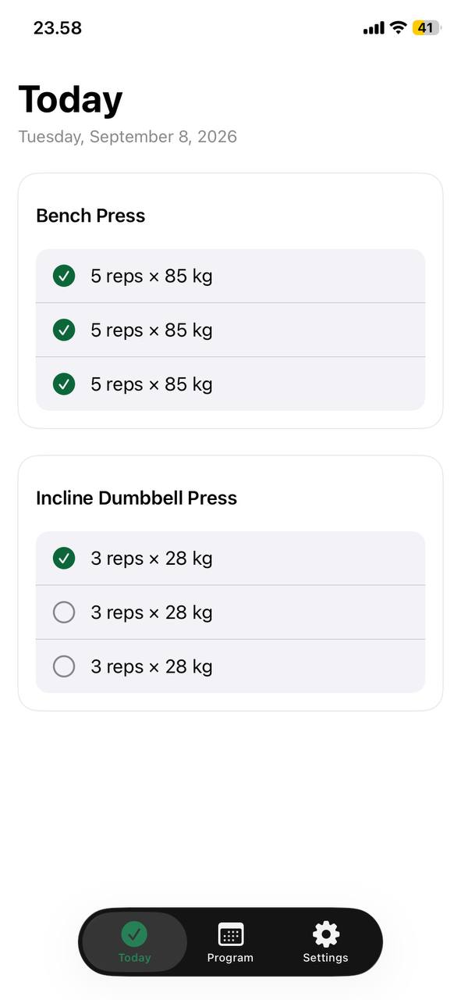
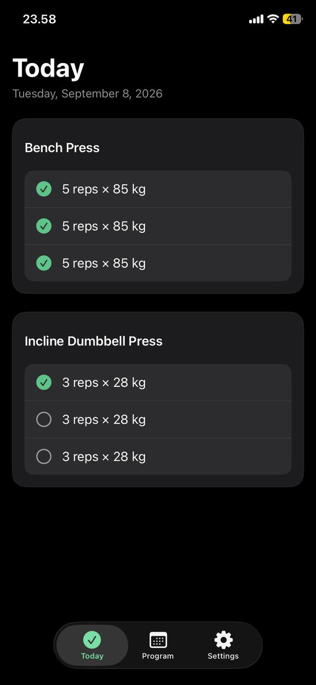
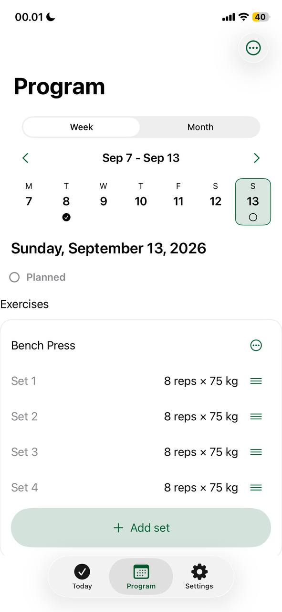

# Gym Checklist

A minimalist iOS app for people who already know their workout plan and want to execute it with almost no thinking or navigation.

> Open app → see today's workout → tap each completed set → close app.

<p align="center">
  
  
  
</p>

_Screenshots were captured on a physical iPhone in September 2026, before the Phase 9 visual redesign._

## Why this exists

Most workout trackers ask you to start a session, browse exercise libraries and read charts between sets. People with a fixed plan do not need any of that in the gym. Gym Checklist keeps roughly 90% of in-gym interaction on one screen, **Today**, and moves everything else (planning, history, settings) behind secondary screens.

Product principles:

1. Today opens first after login.
2. One tap completes a set; one tap undoes it. No modals, no confirmations.
3. No mandatory "start workout" flow.
4. No coaching, recommendations or analytics on Today.
5. Cached workouts stay usable offline.

## Features (MVP)

- **Today:** checklist of the current date's workout, grouped by exercise; long-press a set to edit the plan or the actual values; skip and restore exercises; dismissible completion popup.
- **Program:** week and month calendar, one workout per date, ordered exercises and sets (reorder, swipe to delete), historical editing of actual values.
- **Planning helpers:** copy a workout to another date (add or replace) and repeat it weekly for 1–4 week cadences.
- **Exercises:** bundled searchable catalog plus custom exercises.
- **Sets:** weighted, reps-only or timed.
- **Settings:** kg/lb, System/Light/Dark, profile, dated body-weight history with derived BMI.
- **Accounts:** email/password, Google and Sign in with Apple, in-app account deletion.
- **Offline-first:** writes apply locally first and sync when the connection returns.

Deliberately out of scope for the MVP: statistics and charts, AI coaching, rest timers, Apple Watch/HealthKit, social features, payments, Android/web. The full list and rationale are in [`docs/product_spec.md`](docs/product_spec.md).

## Tech stack

| Area | Choice |
| --- | --- |
| App | Swift, SwiftUI, feature-oriented MVVM, iOS 17+ (iPhone, portrait) |
| Auth | Firebase Authentication (email, Google, Apple) |
| Data | Cloud Firestore with offline persistence |
| Observability | Firebase Analytics (parameter-free events), Crashlytics |
| Backend | One callable Cloud Function, `deleteAccount` (Node.js) |
| CI | GitHub Actions: Linux static checks, macOS build and tests, prototype visual regression |

## Key engineering decisions

- **One Firestore document per workout day**, keyed by `yyyy-MM-dd`, so the Today screen reads a single document and works from cache.
- **Local calendar date, not UTC day,** defines workout identity; date handling is isolated and tested around day boundaries.
- **Weights are stored in kilograms.** kg/lb is a display preference converted at the UI boundary, so switching units never rewrites stored data.
- **Planned vs actual.** Completing a set copies the plan into actual values, which can then be edited independently.
- **Owner-scoped security rules.** Every collection lives under `users/{uid}` and only that user can read or write it.
- **Repository protocols with in-memory implementations** keep view models testable without Firebase.

More detail: [`docs/architecture.md`](docs/architecture.md), [`docs/firestore_security.md`](docs/firestore_security.md), [`docs/offline_test_plan.md`](docs/offline_test_plan.md).

## Getting started

Requirements: macOS with Xcode 16 or newer, and a Firebase project on the free Spark plan.

1. Clone the repository and open `GymChecklist.xcodeproj`.
2. In the Firebase console, create a project, enable Authentication, create Firestore in **production mode**, and register an iOS app with bundle ID `dev.akrasnoslov.GymChecklist` (or your own).
3. Download `GoogleService-Info.plist` into `GymChecklist/`. It is git-ignored; never commit it.
4. Deploy `firestore.rules` and verify owner isolation with two test users (see [`docs/firebase_setup.md`](docs/firebase_setup.md) and [`docs/firestore_security.md`](docs/firestore_security.md)).
5. Select the `GymChecklist` scheme and an iPhone simulator running iOS 17 or later, then run.

Run the tests (unit and UI tests use in-memory data and need no Firebase configuration):

```bash
xcodebuild test \
  -project GymChecklist.xcodeproj \
  -scheme GymChecklist \
  -destination 'platform=iOS Simulator,name=<an available iPhone simulator>'
```

The clickable HTML design prototype opens without a build: open `design/prototype/index.html` in a browser and use **Review gallery** to see every screen state in both themes.

## Quality

- 123 unit tests and 51 UI tests (XCTest).
- macOS CI builds the app and runs a smoke suite on every iOS-affecting pull request; the full suite runs on demand.
- Linux CI runs static contract checks for Firestore owner isolation, offline behavior, account deletion and release configuration.
- The HTML prototype has Playwright visual-regression snapshots for every screen state.

## Project status

The MVP flow is implemented. The Phase 9 visual redesign is merged into `dev` and awaits acceptance on a physical iPhone. The account-deletion Cloud Function source is complete but not deployed, and the app is not yet on the App Store or TestFlight. The exact checkpoint is in [`docs/progress.md`](docs/progress.md).

## Repository layout

| Path | Contents |
| --- | --- |
| `GymChecklist/` | App source: `App`, `Features`, `Core`, `Data` |
| `GymChecklistTests/`, `GymChecklistUITests/` | Unit and UI tests |
| `functions/` | `deleteAccount` Cloud Function |
| `firestore.rules` | Security rules |
| `design/prototype/` | HTML prototype and visual-regression harness |
| `docs/` | Product spec, UX spec, architecture, release notes |
| `scripts/` | PowerShell contract checks run in CI |
| `.github/workflows/` | CI and release workflows |

## How it was built

The project is developed with an AI-assisted workflow: a ChatGPT project chat plans and reviews, and Codex is used as a fallback executor. The rules that govern this are in [`AGENTS.md`](AGENTS.md) and [`docs/source_of_truth.md`](docs/source_of_truth.md). `main` is stable, `dev` is the integration branch, pull requests target `dev`, and nothing is merged automatically.

## License

_To be chosen. Add a `LICENSE` file and name it here._
